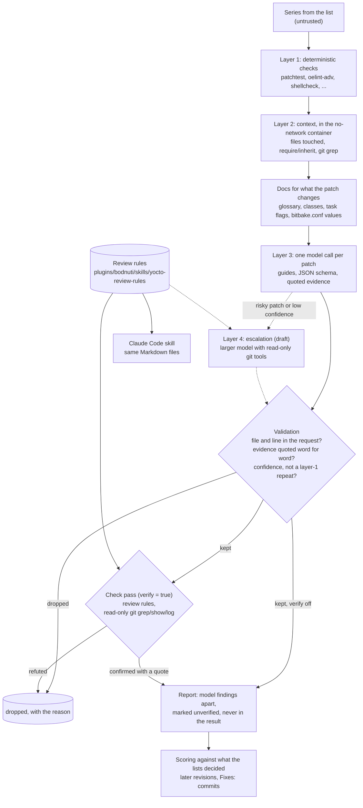

# bodnuti

Automated review of Yocto Project and OpenEmbedded patches. bodnuti runs the
checks OpenEmbedded already has, and reports only what a patch series adds.
It also watches the OpenEmbedded and Yocto Project lists and publishes a
report for each series at <https://bodnuti.dev/reports/>.

For layers and BitBake:

- **patchtest** (OE-Core): commit message, shortlog, Signed-off-by, and the
  `Upstream-Status`, `Signed-off-by` and `CVE:` headers of added `.patch` files;
- **oelint-adv**: recipe, class, include and configuration style and
  correctness rules;
- **shellcheck**: shell in task functions and shipped scripts, run as
  `/bin/sh`, which is dash on many hosts;
- **leftover files**: patch files a series drops from `SRC_URI` but leaves in
  the layer;
- **line length, license changes and CVE_CHECK_IGNORE**: added lines over
  200 characters, LIC_FILES_CHKSUM changes without a `License-Update:` line,
  and added CVE_CHECK_IGNORE after kirkstone, as patchtest's metadata suite
  reports them;
- **documentation** (yocto-docs, BitBake manual): the Sphinx build,
  sphinx-lint, and yocto-docs' check-glossaries and check-confusables.

For other repositories on the lists, such as the Django applications
layerindex-web and error-report-web:

- **cppcheck**: its `error` and `warning` findings in the C files a series
  touches;
- **ruff** and **djLint**: the Python files and Django templates a series
  touches;
- **Django's checks**: `manage.py check` and `makemigrations --check`, in a
  venv with the application's dependencies;
- **trivy**: known vulnerabilities in the application's dependency pins.

Each checker runs on the tree before and after the series, so existing
problems are not blamed on the author. See [`designs/DESIGN.md`](designs/DESIGN.md)
for the design and [`docs/STATUS.md`](docs/STATUS.md) for the current state.

## Usage

```
bodnuti check --repo <layer checkout> <Message-ID | lore URL | mbox files...>
```

- A Message-ID or lore URL is fetched with `b4 mbox`. mbox files can be one b4
  mbox or one `git format-patch` file per patch.
- The base is `--base`, else a branch named by a subject tag such as
  `[scarthgap]`, else `origin/HEAD`.
- patchtest comes from an openembedded-core checkout: `--oecore`, defaulting to
  `--repo`.
- `--json` prints the full report as JSON.

Exit status: 0 clean, 1 findings, 2 a checker could not run or bad input.

### Model review before sending

`--review` also asks an open-weight model to review each patch
([`designs/PHASE3.md`](designs/PHASE3.md)): bodnuti gathers the patch's
context (the files it touches, what they require and inherit, where the
names it changes are used) and sends one request per patch to an
OpenAI-compatible endpoint. Its findings are listed under "model review",
marked unverified, and never change the exit status.

The settings are the `[review]` table of `--review-config`, by default
`~/.config/bodnuti/watch.toml`:

```toml
[review]
endpoint = "https://api.friendli.ai/serverless/v1"
api_key_file = "~/.config/bodnuti/review.key"   # mode 600
model = "zai-org/GLM-5.3-Flash"
guides = "~/sashiko/projects/yoctoproject/prompts"   # optional
docs = "~/docs-index.json"   # optional, from bench/phase3/docs_index.py
verify = true                # the check pass
```

or a model of your own, which sends no key:

```
bodnuti check --review --review-endpoint http://localhost:11434/v1 \
    --review-model qwen3:30b-a3b --repo <layer> <mbox files>
```

A series not yet sent is private: `--review` sends it, with its context,
to the endpoint, so choose one whose data terms you accept.

#### How model review works

Model review adds layers 2 to 4 of [`designs/PHASE3.md`](designs/PHASE3.md)
after the checks. Each step after layer 3 only removes model findings, and
none of them changes the checks' result:



- **Layer 2** gathers context with no network and under a size cap: the
  files a patch touches, what they `require` and `inherit`, where the names
  it changes are used, and with `docs` the documentation and the
  `bitbake.conf` value of each variable, class and task flag it changes.
- **Layer 3** reviews the patch with sashiko's Yocto guides, its
  false-positive guide and severity scale (`guides`), not the review rules:
  with the rules in the request, local models checked patch headers field
  by field and stopped reading the code.
- **The check pass** (`verify = true`) asks the model once more about each
  finding, with the review rules and read-only git tools on the tree after
  the patch. A finding is shown only when the model confirms it with a line
  it quotes from the patch, its context or a tool's output.
- **Layer 4** (`escalation_model`) sends risky patches to a larger model
  with the review rules and the same tools. It is a draft and not yet
  measured.
- **The review rules** are Markdown files condensed from maintainers'
  inline review on the lists, built into bodnuti; a `rules/` directory in
  `guides` replaces them. The same files are the Claude Code skill
  `yocto-review-rules`, so any assistant reviewing or writing a recipe can
  read them.

A finding never changes the exit status or the result. Training a model
instead was tried and stopped
([`designs/TRAINING.md`](designs/TRAINING.md) §8).

#### Hosting the model yourself

Any OpenAI-compatible server works; these steps use
[ollama](https://ollama.com) on one GPU.

1. **The model must fit in GPU memory, context included.** A model that
   spills layers to the CPU runs five to ten times slower. After the first
   request, `ollama ps` must say `100% GPU`.
2. **Pick a quantization that leaves room for the context.** On a 16 GB
   card, gemma4 26B-A4B at 4 bits (`UD-IQ4_XS`, 13.6 GB) with a 24k context
   fits; the default 4-bit builds of 26B to 27B models (17 to 18 GB) do
   not. Leave out the vision projector if the build has one separate.
3. **Make a model with the context set,** for example:

   ```
   ollama pull hf.co/unsloth/gemma-4-26B-A4B-it-GGUF:UD-IQ4_XS
   cat > Modelfile <<'EOF'
   FROM hf.co/unsloth/gemma-4-26B-A4B-it-GGUF:UD-IQ4_XS
   PARAMETER num_ctx 24576
   PARAMETER temperature 1
   PARAMETER top_k 64
   PARAMETER top_p 0.95
   EOF
   ollama create bodnuti-gemma4-26b -f Modelfile
   ```

4. **Point bodnuti at it:**

   ```toml
   [review]
   endpoint = "http://localhost:11434/v1"
   model = "bodnuti-gemma4-26b"
   guides = "~/sashiko/projects/yoctoproject/prompts"
   docs = "~/docs-index.json"
   verify = true
   samples = 3
   context_tokens = 24576   # the num_ctx of the Modelfile
   reasoning_effort = "medium"
   max_tokens = 12000
   ```

   Leave `temperature` unset: the model's own setting applies, and
   reasoning models loop under greedy decoding (temperature 0). A local
   server does not answer the same request the same way twice, so
   `samples = 3` asks three times, merges the findings and lets the check
   pass decide each by majority. `context_tokens` must match the server:
   bodnuti leaves out the context a request needs least until it fits
   with room for `max_tokens`. If a reasoning loop still uses up
   `max_tokens`, bodnuti asks once more at `retry_effort` (default
   `none`; gpt-oss answers nothing without reasoning and wants `low`).
5. **Build the docs index** from yocto-docs, bitbake and openembedded-core
   checkouts:
   `python3 bench/phase3/docs_index.py --yocto-docs … --bitbake … --oe-core … --out ~/docs-index.json`.

What to expect, measured on the patches of 26 November 2026: a 16 GB GPU
answers a patch in seconds to a few minutes, with no tokens bought, but
local models of this size find fewer defects and are less steady from run
to run than a hosted open-weight model such as GLM-5.3, which costs about
$0.03 a patch with the check pass and the docs.

`bodnuti poll` and `bodnuti publish` are the watcher's commands; see
[`docs/DEPLOY.md`](docs/DEPLOY.md).

### With pip

Each [release](https://github.com/moto-timo/bodnuti/releases) has Linux
wheels for x86_64 and aarch64. The wheel carries the binary and pulls in
oelint-adv, b4 and patchtest's requirements; the `docs` extra adds Sphinx
and sphinx-lint. Install one from the release into a venv, or build it with
[maturin](https://www.maturin.rs/):

```
pip install maturin
maturin build --release
python3 -m venv ~/.venvs/bodnuti
~/.venvs/bodnuti/bin/pip install 'target/wheels/bodnuti-<version>-<platform>.whl[docs]'
~/.venvs/bodnuti/bin/bodnuti check --repo <layer> <Message-ID>
```

The venv does not need to be activated: bodnuti uses the `python3`,
`oelint-adv` and `b4` installed beside it. b4 depends on pygit2, which may
have no prebuilt wheel for the newest Python release; use the release before
it if pip tries to compile pygit2.

### In a container

Each release's image is `ghcr.io/moto-timo/bodnuti:<version>`, for amd64 and
arm64; `:main` follows the main branch. The image carries oelint-adv, b4,
shellcheck, cppcheck, ruff, djLint, trivy, patchtest's Python requirements,
and Sphinx with the extensions yocto-docs uses. Mount a clone
of the layer that bodnuti may write worktrees into, not your working
checkout. It must not be a `git clone --shared` of a host repository: its
object alternates point at host paths the container cannot see. For layers
other than openembedded-core, also mount an openembedded-core checkout for
patchtest and set `BODNUTI_OECORE` to it:

```
docker run --rm \
    -v ~/cache/openembedded-core:/repo \
    ghcr.io/moto-timo/bodnuti:0.5.0 check --repo /repo '<20261023192932.159420-1-peter.marko@siemens.com>'
```

`docker build -t bodnuti -f Containerfile .` builds the image from source.
For a server deployment with rootless Podman, a read-only container and no
network during checks, see [`docs/DEPLOY.md`](docs/DEPLOY.md).

### On the host

Install oelint-adv, b4, patchtest's requirements
(`meta/lib/patchtest/requirements.txt`) and, for documentation, the packages
in yocto-docs' `documentation/Pipfile` plus sphinx-lint, in one venv. Point
bodnuti at it with `--python`, `--oelint` and `--b4` (or `BODNUTI_PYTHON`,
`BODNUTI_OELINT`, `BODNUTI_B4`). shellcheck runs from its container image by default; set
`--shellcheck shellcheck` to use a local binary.

### In Claude Code

The bodnuti plugin checks a series from Claude Code, in the container
image; see [`plugins/bodnuti/README.md`](plugins/bodnuti/README.md):

```
/plugin marketplace add moto-timo/bodnuti
/plugin install bodnuti@bodnuti
```

## Verifying a release

Each release's wheels and container image carry SLSA build provenance and
an SPDX 2.3 SBOM, both signed through Sigstore by the Release workflow, and
the image a keyless cosign signature. The wheels' SBOM lists the Rust
crates in the bodnuti binary; the image's, one per platform, its Debian,
Python and Go packages. The SBOMs are also attached to the GitHub release.

```
gh attestation verify bodnuti-0.5.0-py3-none-manylinux_2_28_aarch64.whl --repo moto-timo/bodnuti
gh attestation verify oci://ghcr.io/moto-timo/bodnuti:0.5.0 --repo moto-timo/bodnuti
cosign verify ghcr.io/moto-timo/bodnuti:0.5.0 \
  --certificate-identity-regexp '^https://github.com/moto-timo/bodnuti/\.github/workflows/release\.yml@refs/tags/v' \
  --certificate-oidc-issuer https://token.actions.githubusercontent.com
gh attestation verify oci://ghcr.io/moto-timo/bodnuti:0.5.0 --repo moto-timo/bodnuti \
  --predicate-type https://spdx.dev/Document/v2.3
```

The image of `main`, `ghcr.io/moto-timo/bodnuti:main` (and `:main-<commit>`),
is built, attested and signed the same way by the Main image workflow on
every push that changes what goes into it; its certificate names that
workflow and `main`:

```
cosign verify ghcr.io/moto-timo/bodnuti:main \
  --certificate-identity https://github.com/moto-timo/bodnuti/.github/workflows/main-image.yml@refs/heads/main \
  --certificate-oidc-issuer https://token.actions.githubusercontent.com
```

The source has SLSA source provenance too: each push to `main` and each
tag gets a signed source provenance attestation and verification summary,
kept in git notes, which the
[SLSA source tool](https://github.com/slsa-framework/source-tool) checks
(tags from `v0.3.0` on also carry tag provenance, and from `v0.5.0` on at
SLSA Source Level 3):

```
sourcetool verify moto-timo/bodnuti --tag v0.5.0
```

## License

bodnuti is licensed under either of the [MIT license](LICENSE-MIT) or the
[Apache License, Version 2.0](LICENSE-APACHE), at your option. Unless you
say otherwise, a contribution you submit for inclusion is licensed the same
way, without further terms.

The container image also carries the tools bodnuti runs, each under its own
license: among them shellcheck and cppcheck (GPL-3.0), trivy (Apache-2.0),
oelint-adv (BSD-2-Clause), b4 (GPL-2.0), and the Debian packages of the
base image.
